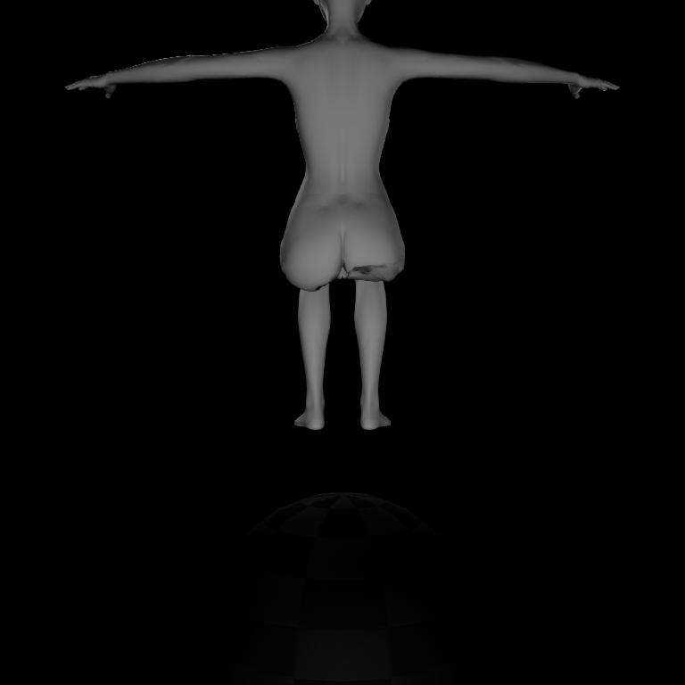
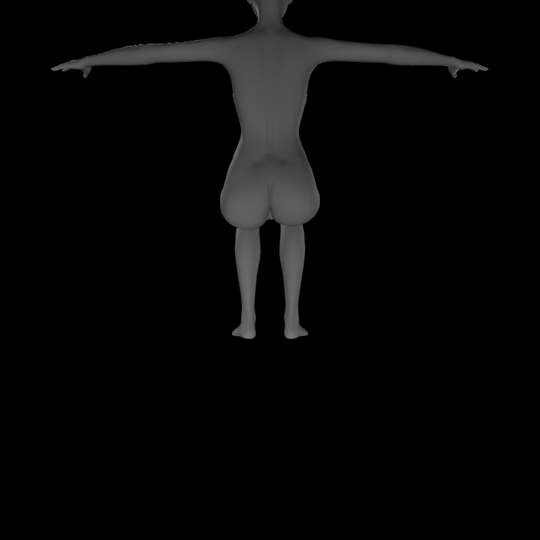
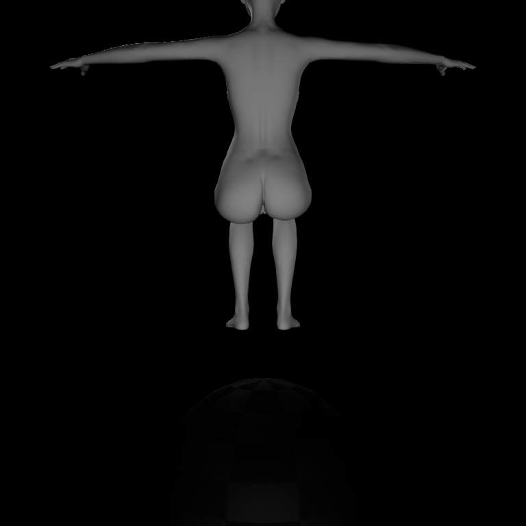
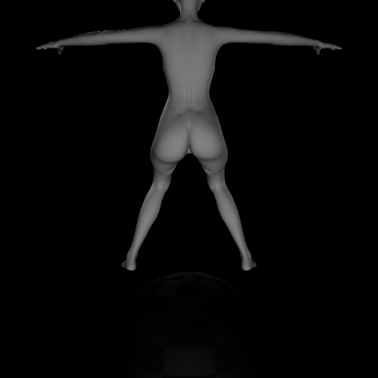

# Residual-only production corrective

Implementation: `f37a386`. New runtime identity: `330820d9f44ce116cf1383a3b581db5faa013267531056f20adbe9d122e9f4fe`.

15 UE automation tests, 11 PIE poses, 4 Editor poses, 480 screenshots, 11 A1 replays, B2 exact rebake. Additional normal BP seated Editor/PIE runs in installed SmartNPC project: 64 screenshots. Code and binary changes are real, not a transient morph override.

Local HTML report: `I:/Document/UE5/SmartNPC/Plugins/VamResourceBrowser/Saved/LowerBodyContact/GluteSafetyRepair/residual-only-r2/report.html`.

Source/procedural attenuation is removed. Residual guard uses the immutable source/procedural surface as its reference. It does not certify that reference or repair pre-existing source folds. Full-surface guard violations remain recorded in authored-targets.json. Contact history is excluded from this policy acceptance.

Screenshots below are unchanged UE captures; source paths and SHA256 are in selected-screenshots.json.

| Previous attenuation | New production residual-only | Historical all-off diagnostic |
|---|---|---|
|  |  |  |

Abduction still has an inner fold:

Runner scripts are archived as text. Their original location is the local report directory; immutable historical outputs were not overwritten.
