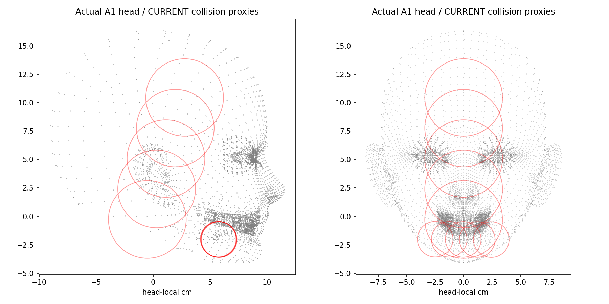
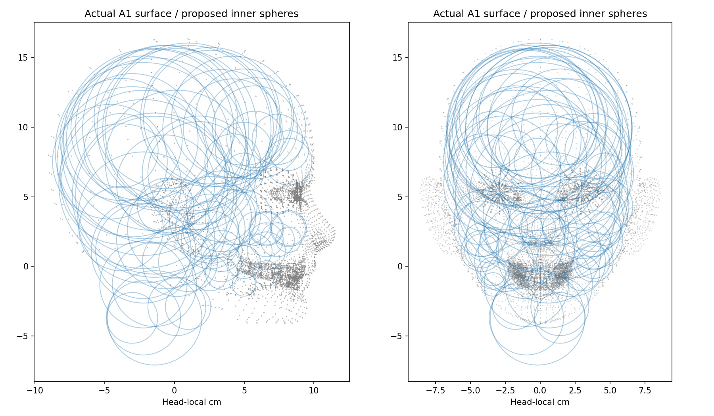
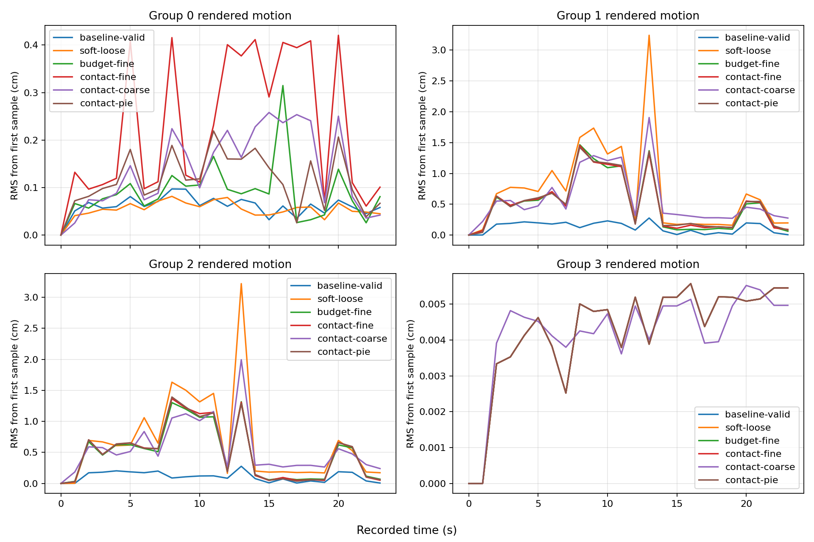
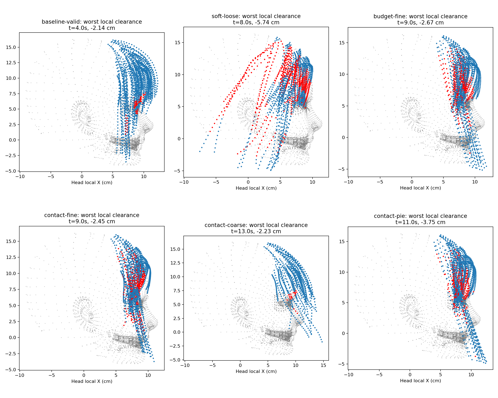

## A · 已证实的原因
**诊断已完成，联合修复候选尚未通过脸部接触验收。未切换默认角色，未覆盖主工程 DLL。** 下面同时公开改善和失败数据，不能把候选录像理解为已解决全部问题。

物理确实运行，且能传到最终渲染发丝；原版两侧散发弯曲约束过强，运动响应很小。只去掉自定义发型保持约束，导向发丝峰值几乎不变；进一步将原生弯曲刚度乘 0.01，最终渲染运动明显增大，但穿模恶化。这是诊断探针，不能直接当成正式修复。

旧碰撞代理通过所有静态发丝的最小间距缩小：头部半径从 10.87 cm 缩至 3.41 cm，无法覆盖脸部。另一个结构问题是自定义发型保持放在原生碰撞投影之后，有机会重新把节点拉回碰撞体内。

## B · 候选改变
散发弯曲基值从 5 降至 0.2，仍除以代表发丝数；这属于工程响应标定，不能当作实测头发杨氏模量。发髻/贴头组弯曲参数不变。发型保持移到原生杆约束和碰撞投影之前，让最终碰撞具有优先权。

头部代理由实际 A1 表面在头骨局部空间生成内接球，不按发型名或当前角色写死。完整身体用于内外判定，避免截取头部留下的颈部开口。构建时保留最多 64 个头部球，并依据其余人体图元数量限制总预算低于原生 100 上限。最初 80 球候选实跑报警，已排除。图中显示拟合的 80 球候选池，运行时使用有序预算子集。

`budget-fine` 仍用原生缓存的最近图元索引；`contact-fine` 在最终投影中改为按当前节点位置重新查询最近图元。深入头部代理超过 0.2 cm 的自由节点峰值从 328 降到 34，证明缓存接触是问题之一，但没有清零。球内距离是针对实际运行代理的解析距离；它与下方近似皮肤表面距离是两种不同指标。

## C · 最终渲染发丝确实运动了吗
以下为头部局部空间、相对于首帧的渲染位移 RMS 峰值，单位 cm。它包含惯性、空气阻力、重力及碰撞的联合响应，不是空气阻力单独贡献。组 0 为贴头部分，组 1/2 为两侧散发，组 3 为发髻。

| 实跑 | 贴头 | 散发 1 | 散发 2 | 发髻 |
|---|---:|---:|---:|---:|
| baseline-valid | 0.097 | 0.277 | 0.276 | 0.006 |
| soft-loose | 0.082 | 3.241 | 3.220 | 0.006 |
| budget-fine | 0.315 | 1.466 | 1.317 | 0.006 |
| contact-fine | 0.421 | 1.453 | 1.367 | 0.006 |
| contact-coarse | 0.258 | 1.907 | 1.994 | 0.006 |
| contact-pie | 0.219 | 1.423 | 1.393 | 0.006 |

只采样活动 LOD 的发丝缓冲区；不同帧按实际 point ID 交集匹配，不统计未激活的缓冲尾部。导向发丝及渲染发丝每秒回读一次，无法排除两次采样间的瞬时异常。回读同步会影响性能，本视频不作为真实帧率测试。

## D · 表面距离检查与限制
以下使用真实角色 A1 最终权重/Morph 蒙皮表面，在头骨局部空间与导向发丝比较。排除每条导向发丝前 10% 的附着区域。三角形朝向由整体有向体积确定。

这是最近 48 个三角形候选的局部有符号距离诊断，不是严格的闭合体穿透证书；不是精确脸部接触深度。头部表面来自 A1 CPU 重构，当前 Mesh Deformer 未启用，未伪称为身体 GPU 表面。静态原始导向发丝也分别记录距离，避免将源形状已有交叠全部归给动态求解。球代理仍不能完全贴合鼻翼、眼睑等细节；发丝之间自碰撞未由本轮验证。

[距离统计](surface-clearance-summary.json) · [静态源发丝距离](rest-clearance.json) · [逐帧数据](surface-clearance.csv)

## E · 可复现身份与验证
正常 BP：`/Game/VamHairRuntime/H_88938ac455bbaee841b3dd83/BP_VamCharacter.BP_VamCharacter`。源发丝、宽度和资源组合保持不变；候选使用独立身份。精细与粗略档均运行同一 24 秒轨迹，镜头环绕；包含起步、走路、转身、跑步、急停、跳跃和蹲起。

编译和 19 项已有头发测试结果另附。Editor 独立重载与 PIE 的真实完成状态见 delivery.json；不把 Game 录制称为 PIE。候选画面和数值必须同时检查，数值非零不能单独证明效果正确。

[资产清单](bundle.json) · [运行参数](runtime-parameters.json) · [运动 CSV](metrics.csv) · [交付状态](delivery.json)
