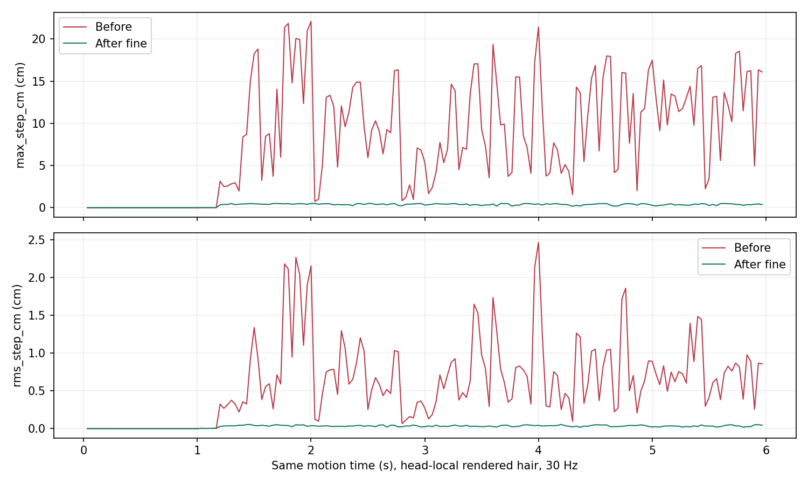

## A · 本轮结果
已完成生成链路修复、重新生成正常 BP_VamCharacter、两档完整运动重放及 PIE、真实 Editor 绑定与切档检查。下方视频采用同一 SmartNPC 主工程、角色身体、24 秒运动、相机、曝光与灯光；左边修复前，右边修复后。四个发组的自碰撞黏性均为 0。

**验证范围是当前角色和这段运动，不是所有发型、所有动作的零穿模保证。** 数值检查与真实画面一起提供，最终观感请直接看完整视频。

## B · 发髻为什么抖
原先发型保持约束在杆约束之前，后续杆投影可以撤销它；随后人体碰撞又会推出本来埋入头部的附着路径，与发髻支撑产生冲突。部分问题节点静态已位于头部代理内约 2.5–4.6 cm。只去掉头发自碰撞没有解决大幅跳变；换成原生 Angular Springs 也没有解决。

修复将支撑约束移到杆投影之后；已有埋入路径按附着部分处理；发髻和贴头组在最终输出再次遵守其附着范围。散发仍由原生碰撞得到最终约束。保留有限活动，没有将所有头发变成一个刚体。

同一主工程前 6 秒中，发髻渲染采样点的最大单帧位移：**22.08 cm → 0.499 cm**。该值是 30 Hz 下头部局部空间位移，不是求解器的物理速度；少数点的最大值与整组 RMS 分开看。

[早期消融统计](ablation-summary.json)：关闭黏性仍跳变；关闭人体碰撞明显改善；只刷新接触查询仍失败；修正约束顺序后明显改善。早期消融使用隔离宿主，与这里重新录制的主工程对照分别保留。

## C · 脸部穿模为什么只调半径不够
旧头部代理偏重内部体积覆盖，未保证外表面覆盖。现在从实际身体的头部皮肤离线生成封闭外包络，以 64 个原生球形图元拟合，并受原生总图元预算限制。运行时没有逐帧 CPU 三角面碰撞。

导向发丝与最终渲染发丝必须分开检查：导向碰撞通过后，可见发丝仍可能因为插值偏移穿入。粗略档最差点距离最近导向点约 2.1 cm。只扩大包络、只换单导向插值均未消除该点，后者已撤回。最终增加粗略档散发的导向覆盖，保留原有平滑插值。

原生 CollisionRadius 对散发设为精细 0.8 cm、粗略 1.1 cm，用作代表发束的接触包络，**不是单根头发的真实直径**。这是本轮工程标定值。静态源发丝、宽度、发型组合未改动；动态平衡形状会受正确碰撞影响。

| 物理预算 | 精细 | 粗略 |
|---|---:|---:|
| 导向曲线总数 | 393 | 192 |
| 每条求解粒子 | 32 | 16 |
| 子步 / 迭代 | 5 / 8 | 3 / 4 |
| 渲染发丝数量 | 38,923 | 38,923 |

## D · 实际输出检查
| 运行 | 世界 | 视频帧数 | 发髻最大帧位移 cm | 前 6 秒整组 RMS 帧位移 P95 cm |
|---|---|---:|---:|---:|
| fine | Game | 720 | 0.499 | 0.0499 |
| coarse | Game | 720 | 0.498 | 0.0750 |
| pie-fine | PIE | 720 | 0.500 | 0.0478 |
| pie-coarse | PIE | 720 | 0.498 | 0.0755 |

精细：导向发丝采样最大穿入 0.0000 cm，可见散发采样最大穿入 **0.0630 cm**。粗略：对应数值为 0.0000 / **0.0000 cm**。两档超过 0.2 cm 的采样点均为零。PIE 独立重放也重新采样：精细可见发丝最深 0.0567 cm，粗略为 0，导向点均为 0。

运动跳变按每个视频帧回读；完整几何每秒保存一次。皮肤检查覆盖全部导向点和每个发组约 2,048 个固定 ID 的渲染点，排除根部附着段。使用实际 A1 身体表面、外包络排除及广义绕数，不再将最近三角形法线符号直接当作内外证明。源表面开口/非流形仍是距离判定的限制；采样未覆盖每条发丝的每个时刻。

[精细皮肤数据](final-fine-skin.json) · [粗略皮肤数据](final-coarse-skin.json) · [完整录制凭据](recordings.json)

## E · 性能，独立于录制
RTX 4070 Ti 12 GB，i5-12600KF，驱动 616.56，UE 5.8，1920×1080。每阶段预热 180 帧、测量 300 帧，关闭 VSync 和帧率上限。场景为正常人物根部平移/旋转、臀腿 Jiggle 开启、Contact 关闭。**这些是整个基准帧的墙钟耗时；增量包含头发渲染与模拟，不是孤立的 GPU 求解器耗时，也不是录制视频的 30 FPS。**

| 基准 | 档位 | 平均 ms | P95 ms | 平均 FPS | 相对前后关闭头发均值的增量 ms |
|---|---|---:|---:|---:|---:|
| baseline-1 | fine | 11.92 | 14.35 | 83.9 | +3.71 |
| baseline-1 | coarse | 11.69 | 14.59 | 85.5 | +3.48 |
| final-1 | fine | 8.43 | 11.09 | 118.6 | +0.88 |
| final-1 | coarse | 10.80 | 14.31 | 92.6 | +3.25 |
| final-2 | fine | 9.55 | 12.11 | 104.7 | +1.25 |
| final-2 | coarse | 12.13 | 15.33 | 82.5 | +3.82 |
| final-1-repeat | fine | 10.69 | 13.69 | 93.5 | +3.52 |
| final-1-repeat | coarse | 10.67 | 13.28 | 93.7 | +3.50 |
| final-2-repeat | fine | 12.01 | 14.33 | 83.3 | +3.66 |
| final-2-repeat | coarse | 12.63 | 16.67 | 79.2 | +4.28 |

关闭前后漂移：旧版单人 +0.50 ms；新版单人 +1.75 ms；新版双人 +0.43 ms。不是服装、完整关卡、所有玩法都开启后的保证帧率。复测行也完整列出：粗略档在当前场景中未证明更快，不能据粒子预算推断实际帧率；单轮的关闭前后漂移也说明不能把两个总帧时简单相减当成精确求解器成本。

[旧版单人 CSV](benchmark-baseline-1.csv) · [新版单人 CSV](benchmark-final-1.csv) · [新版双人 CSV](benchmark-final-2.csv)

## F · 工程交付与范围
正常角色：`/Game/VamHairRuntime/H_171a2fec712e0a8bcdec2204/BP_VamCharacter.BP_VamCharacter`。资产身份：`171a2fec712e0a8bcdec22043059cf23e2f0930c9ea2161f4713721076a6e9bb`。该身份下的 RuntimeConfiguration、Hair Profile、两档 Groom、PhysicsAsset 和 Niagara 模块已重新生成并独立重载。旧资产和历史证据保留；已有旧关卡实例不会被静默改指向新配置。

根因修改：`VamHairStyleSolver.h` 的约束顺序、当前接触查询、附着路径分类与最终范围；`VamHairBuilder.cpp` 的自碰撞关闭、碰撞包络和粗略散发导向覆盖。分类依赖源几何/支撑信息，没有按发型名称或当前角色写分支。

19 项现有头发测试通过，C++ 构建成功。Editor 使用真实可见视口，验证正常角色头部绑定、两档切换、四组 Niagara 实际激活、资产绑定与参数；运动和 GPU 表面证据来自独立运行及 PIE。PIE 捕获完成后退出 PIE 不会自动关闭其宿主编辑器，因此 runner 仅在凭据完整后关闭自己的进程，记录真实退出码，未把它伪装成自然退出。

插件模块已备份并安装到主工程，哈希见安装凭据。当前仅验证这个发型与身体组合；新体型要重新拟合碰撞包络，张嘴/表情、其他发型需额外验证。没有改写引擎安装目录内的求解器资产。

[资产清单](bundle.json) · [Editor 检查](editor-check.json) · [安装哈希](installation.json) · [构建日志](compile.log) · [测试日志](tests.log)

原生接口依据：[Epic Groom 物理配置](https://dev.epicgames.com/documentation/en-us/unreal-engine/enabling-physics-simulation-on-grooms-in-unreal-engine)，其中 Strand Viscosity 控制自碰撞黏性，PhysicsAsset 与 CollisionRadius 用于人体代理碰撞。本报告的具体根因与数值来自本项目实跑，不是文档保证。
